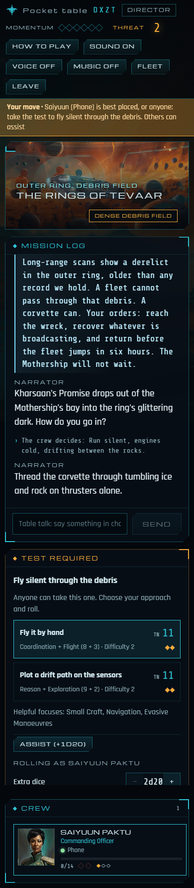
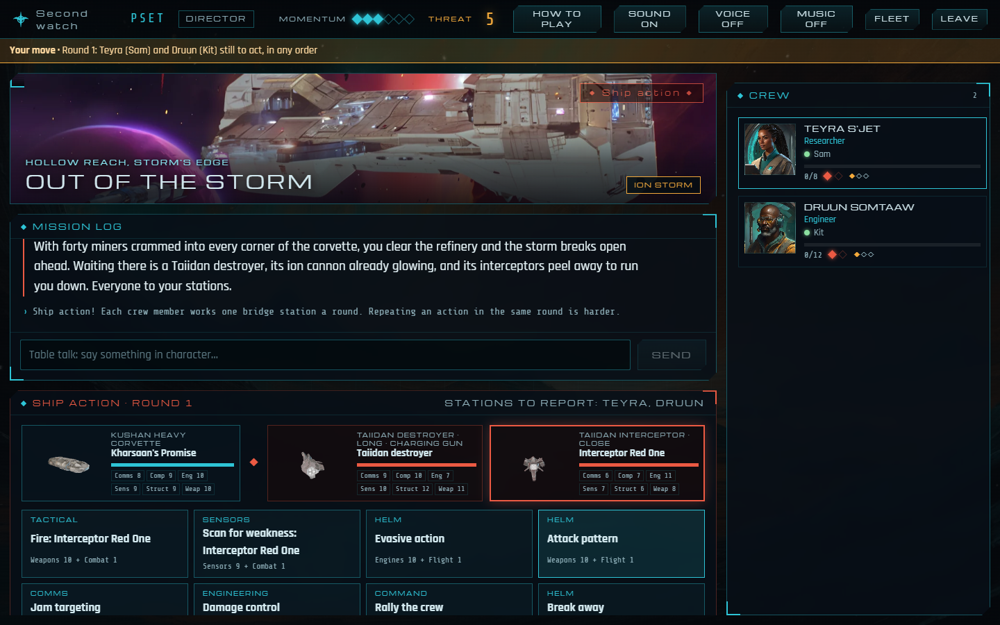
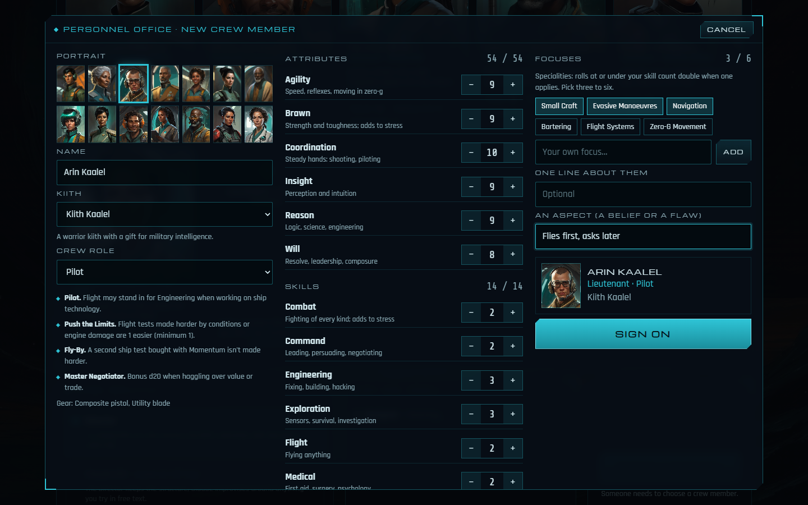
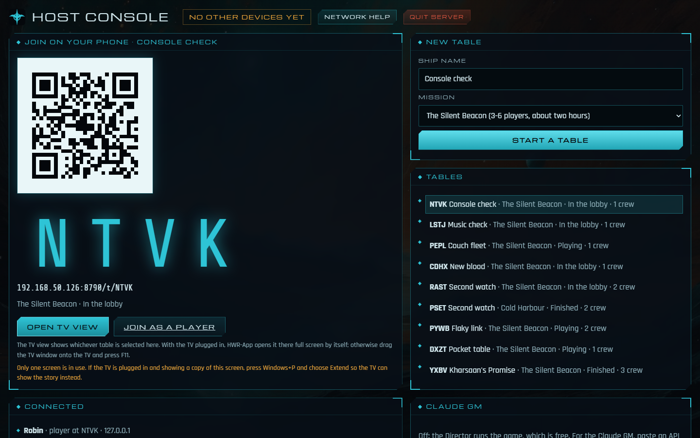
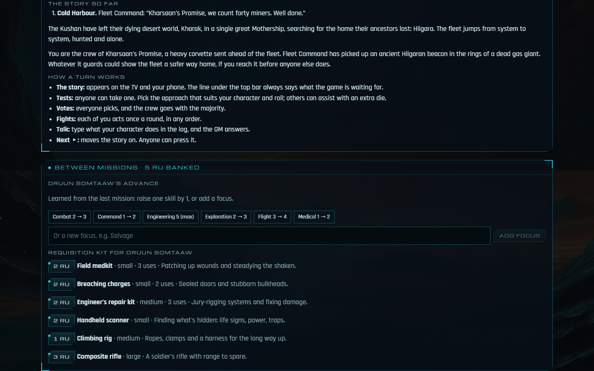

# Homeworld: Revelations, a digital table

A browser-based digital table for **Homeworld: Revelations**, the tabletop role-playing game set in the Homeworld universe. Up to six people play the crew of a Kushan ship on their phones, with the story on a shared TV, and **nobody has to be the Game Master**. A scripted Director runs each mission, or an AI Game Master built on Claude improvises around the players.

It began as campaigns played with Claude as the GM and grew into an app my family plays on game nights.

> An unofficial, non-commercial fan project, not affiliated with Gearbox Software, Blackbird Interactive or Modiphius Entertainment. The code is [MIT licensed](LICENSE); the Homeworld setting, the Revelations rules and the fan art are not (see [NOTICE](NOTICE.md)).


## What it does

- **Phones as character sheets, the TV as the table.** Players join with a four-letter code or a QR code. Each phone shows their character, the roll builder and whose move it is. The TV shows the scene art, the story and the dice, and reads the narration aloud.
- **The 2d20 rules, automated.** Tests, Momentum, Threat and Fortune, assists, extended tests, stress and injuries, and combat are pure, tested functions. The roll builder shows live odds before you commit.
- **Ship battles.** Each player takes a bridge station (tactical, helm, sensors, comms, engineering, command) against fleets that scale with the crew. Hits breach ship systems.
- **Two Game Masters.** The **Director** runs missions written as validated node graphs, free and offline. The optional **Claude GM** narrates, voices characters and calls for tests through a tool-use loop.
- **Campaigns.** Finished missions become chapters. Crews carry their kit, advances, wounds and scars into the next mission, with a "previously…" recap.
- **Local narration voices.** Kokoro text-to-speech runs on the host PC in a worker thread. Speech is made ahead of time, and the browser's own voices take over on slow machines.
- **A Windows launcher.** A portable build with a tray icon puts the host console on the laptop and the story full screen on the TV.

| Phone | TV | Ship battle |
|---|---|---|
|  |  |  |

| Character designer | Host console | Between missions |
|---|---|---|
|  |  |  |

## How it's built

A TypeScript monorepo (pnpm workspaces and Turborepo):

| Package | What it is |
|---|---|
| [`packages/rules-engine`](packages/rules-engine) | The 2d20 rules as pure functions with seeded dice, so every outcome is reproducible in tests |
| [`packages/protocol`](packages/protocol) | The client–server messages and table state, shared by both sides |
| [`packages/content`](packages/content) | Crew, NPCs, equipment and missions, each mission a node graph validated at load |
| [`apps/server`](apps/server) | Node 24, Fastify 5 and WebSockets. Authoritative game state, the Director and Claude GMs, SQLite saves (`node:sqlite`), and Kokoro speech in a worker thread |
| [`apps/web`](apps/web) | React 18 and Vite: the Homeworld-style HUD, roll builder, 3D dice (three.js), TV view and host console |
| [`tests/e2e`](tests/e2e) | Playwright: real browsers play whole missions, and the same run captures the screenshots used in the docs |
| [`tools/package`](tools/package) | The portable Windows build: an esbuild bundle, a bundled Node runtime and a small C# tray launcher |
| [`tools/art`](tools/art), [`tools/ship-studio`](tools/ship-studio) | The art pipeline: local Stable Diffusion (ComfyUI) painting over 3D renders of the game's ships |

Some design choices:
- **The server owns the game.** Phones send intentions such as "roll", "vote" or "take the helm"; the server validates them against the rules and broadcasts state. A dropped phone rejoins its seat and character.
- **Testing in layers.** About 130 unit tests (including 300 simulated playthroughs of every mission with 1 to 6 bots), 12 Playwright end-to-end tests, and a "virtual family". The virtual family is a timed whole-mission run over real WebSockets, with speech, against a live server. It was built after a real family playtest on a laptop found what desktop tests couldn't.
- **Licensed material stays local.** The corebook, game models, music and sounds live in a git-ignored private folder that the app uses if it's there. The repository only holds code and generated art.

The [docs](docs/Home.md) folder is the project wiki: design notes, decisions, iteration reviews and how each feature works.

## How it was made

I designed and directed this project and used [Claude Code](https://claude.com/claude-code) as a pair programmer throughout. The work was planned on a board, as user stories and bugs, with a branch and review for each change. Playtests at the family table fed straight back into the backlog; the [iteration reviews](docs/Iteration-Reviews.md) tell that story.

## Download for Windows

Each [release](../../releases) has a portable Windows build: unzip it anywhere and double-click `HWR-App.exe`. It needs no install and no developer tools.

> **The launcher is unsigned, so antivirus may flag it.** `HWR-App.exe` is a small tray program compiled from [`Launcher.cs`](tools/package/launcher/Launcher.cs). It starts the bundled Node.js server in the background and opens the host console. Because it's new, unsigned and starts a hidden process, Windows SmartScreen may say *Windows protected your PC*, and some antivirus products (Norton, for one) report it as a generic threat. Check the zip against the SHA-256 on the release page. If you'd rather not run the launcher, double-click **`Start without launcher.cmd`** instead. It's a short script you can read first, and it starts the same server in a visible window and opens the host console in your browser. Or run from source as below.

The download leaves out the licensed extras (ship models, music, sound and the voice model), so it uses synthesised sound and the browser's own voices.

## Run it from source

You need Node 24 and Corepack (it comes with Node).

```bash
corepack pnpm install
corepack pnpm --filter @hwr/web build
corepack pnpm start          # then open http://localhost:8787
```

Open the host console at `http://localhost:8787/host` and start a table, then join from a phone on the same network using the QR code. The Director needs nothing else. For the Claude GM, paste an Anthropic API key into the host console.

```bash
corepack pnpm test           # unit tests and simulated playthroughs
corepack pnpm typecheck
```

The game runs without the private folder: ship models, music, sound effects and local voices simply switch off. See [Getting Started](docs/Getting-Started.md) and [Private Folder](docs/Private-Folder.md).
