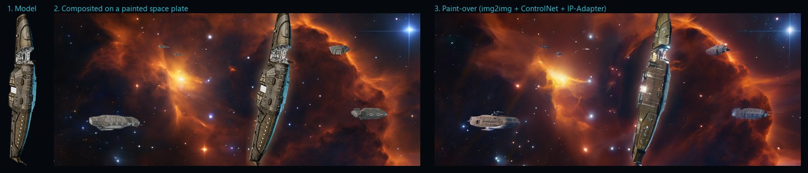

# Art Pipeline

All the app's art is generated locally on this PC with ComfyUI (AMD 7900 XTX). The goal is art that looks like the real Homeworld: recognisable units and the painted, cinematic feel of Homeworld Remastered.



## Three kinds of art

1. **Plain scenes and portraits**: `tools/art/generate.py` with `prompts.json`. SDXL text-to-image, optionally steered by **IP-Adapter** towards reference pictures (`refs`).
2. **Scenes with real ships**: `tools/art/compose.py` with `scenes.json`:
   1. paint a background plate (no ships);
   2. composite renders of the actual game models onto it;
   3. **paint over** the composite with SDXL img2img (denoise about 0.45). ControlNet edges keep every ship's exact silhouette, and IP-Adapter matches in-engine shots from the corebook.
3. **Ship renders**: `tools/ship-studio`, a three.js page that loads the Homeworld Remastered 1.0 source models (meshes, diffuse, glow and team-colour textures) and renders them from any angle with a transparent background.

## Where the source material lives

| Source | Location | Committed? |
|---|---|---|
| Corebook art (references) | `reference/art-refs/` and `ComfyUI/input/hwr-refs/` | No (licensed) |
| HWRM 1.0 source ships | `D:\Modding Tools\…\Homeworld Remastered 1.0 source files`, copied to `reference/ships/` | No (licensed) |
| Ship renders and composites | `reference/renders/`, `reference/compose/` | No |
| Finished art | `apps/web/public/art/` (WebP, Git LFS) | Yes |

## Doing it

```bash
# 1. ComfyUI must be running (D:\ComfyUI_windows_portable\run_amd_gpu.bat)
# 2. Ships: copy models and textures, then render the shots in shots.json
D:\ComfyUI_windows_portable\python_embeded\python.exe tools/ship-studio/prep.py
pnpm --filter @hwr/ship-studio dev          # leave running
node tools/ship-studio/render.mjs
# 3. Scenes with ships (two variants each)
D:\ComfyUI_windows_portable\python_embeded\python.exe tools/art/compose.py scenes/title
# 4. Pick the best variant
D:\ComfyUI_windows_portable\python_embeded\python.exe tools/art/generate.py --pick scenes/title=2
# Private art (a private mission's scenes) uses its own prompt file and output folder
D:\ComfyUI_windows_portable\python_embeded\python.exe tools/art/generate.py --spec reference/missions/art.json --out reference/missions
```

## Portraits of friends and family (#594)

Crew portraits in the likeness of the people at the table, painted in the same style as the app's crew. Everything stays on this PC: photos, settings and portraits live in git-ignored `reference/`, generation runs only on the local ComfyUI, and no real face goes into git, CI, the board or this wiki.

| Step | Command (ComfyUI's Python, ComfyUI running) | Writes |
| --- | --- | --- |
| 1. Seeds | Put photos in `reference/art-refs/avatars/avatar_seed_N.png`; extra photos of the same person as `avatar_seed_Nb.png` | |
| 2. Enhance | `tools/likeness/prepare.py` | `reference/likeness/prepared/seed_N.png`, 1024 x 1024 |
| 3. Paint | `tools/likeness/portraits.py [--only 2 5] [--variants 3]` | `reference/likeness/portraits/seed_N.vK.png` |
| 4. Review | `tools/likeness/review.py` | `reference/likeness/review.jpg`: each seed beside its variants |
| 5. Pick | `tools/likeness/pick.py 1=2 2=1` | `reference/portraits/family-N.webp` and `index.json` |

Restart the server after picking. On a PC that has `reference/portraits`:
- **Family faces replace the stock gallery.** They take over gallery slots of the same sex, in seed order: men in slots 1, 3, 4 and 7, women in 2, 5 and 6, anyone in 8. The server answers requests for `/art/portraits/gallery-N.webp` with the family portrait, so every place that shows a gallery portrait shows a family face.
- **The rest get their own row.** Family portraits without a slot appear under **Family and friends** in the designer.

Without that folder, nothing changes: the stock gallery is served, and saved characters that used a family portrait fall back to a stable gallery portrait.

**How it works.**
- **Enhance:** flatten transparency onto grey, take a square crop weighted towards the top, upscale with 4x-UltraSharp, and for small sources run a light (0.28) SDXL tile-ControlNet pass to restore detail.
- **Paint:** RealVisXL with IP-Adapter FaceID Plus v2 and its LoRA (InsightFace `buffalo_l` for face analysis), using the crew portrait style from `tools/art/prompts.json`.
- **Roles:** each person gets a crew role (pilot, engineer, researcher, medic, security, comms, navigator, scout, technician, gunner, captain, scholar) with its own clothes, props and background, rotating by seed. `"role"` in `people.json` picks one. Medals, epaulettes and dress uniforms are in the negative prompt.
- **Description:** the prompt gives only an apparent age, estimated by InsightFace, and never a sex. Estimates are unreliable, especially for children, and the face model carries it anyway.

**Ageing children up.** `reference/likeness/people.json` (private) sets an adult age per seed, e.g. `{"2": {"age": 25, "adult": true, "hint": "clean-shaven", "avoid": "moustache, beard"}}`. Age-ups:
- get adult cues in the prompt and child cues in the negative;
- use a low general-image weight (0.45) and a high identity weight (1.1);
- start the likeness 15% of the way in, so the first steps form an adult face.

Facial hair goes in `avoid` rather than "clean-shaven" alone, because prompts often ignore negations. Pick variants that clearly read as adults.

**Safety.** Only realistic, non-stylised models are used, with no other LoRAs. Every portrait has a negative prompt against nudity and sexualised content.

**Lessons.**
- The first try, on SDXL base with the age-up done only by prompt, kept a child's face and drifted from the likeness.
- Splitting the two FaceID weights and delaying the identity fixed both problems.
- One shared "officer in uniform with rank insignia" prompt made everyone look like a parade-ground general. Varied working roles, like the crew portraits, fixed it.

## What we learnt

- **IP-Adapter alone** gets the palette and mood but invents its own ships. Rendering the **real models** and painting over them is what makes the Mothership the Mothership.
- **Denoise is the dial**: around 0.45 keeps the model's detail, 0.55 and up starts redesigning the ship. ControlNet canny at 0.6 holds the silhouette while the paint-over relights it.
- Game textures pack data into channels: glow maps use G and B for other things (the Mothership's bay glowed green until the map was converted to greyscale), and only the red channel of a team map is the team-colour mask.
- The source models use different axis conventions, so the studio auto-orients them (longest axis horizontal, shortest up), with an override for tall hulls like the Mothership.
- **Space ships stay in space.** The Mothership and the fleet's other big ships never land or fly in an atmosphere: they're built in orbit and only ever jump between systems. Scenes with them use a space plate (`"space": true` in `scenes.json`). It's painted square and cropped, with the no-landscape negative on both the plate and the paint-over, and no planet-surface references. An earlier title asked for "high orbit above Kharak", and SDXL put the Mothership low over the dunes.
- Always render several variants and compare them on a contact sheet. One generated portrait had a US flag patch, which an automated pass would never have caught.

Next: Deserts of Kharak ground units for the Kharak scenes (#378), and a 3D ship viewer using the same models.
