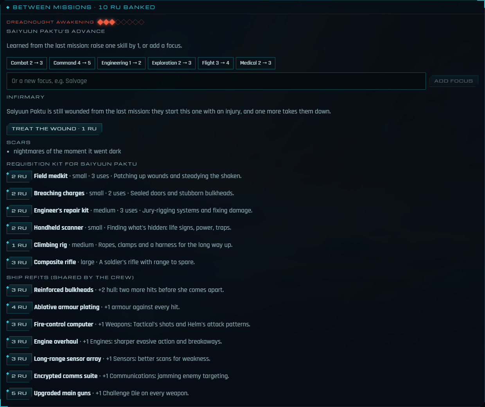

# Campaign

A campaign carries a crew from one game night to the next: the same characters, their kit, their wounds and scars, the Requisition they earned and the story so far.


## How it plays

1. **Finish a mission.** It becomes a chapter of the campaign: how it ended, the RU earned, who was there and any scars earned. Every crew member who took part earns an **advance**.
2. **Continue the campaign** on the debrief (anyone can press it). A new table starts with the same crew, and every phone and the TV move across by themselves. Players keep their seats and characters, and kit is kept (anything lost or broken stays behind). Stress clears, but wounds may not (see below).
3. **Between missions**, in the lobby:
   - **Spend the advance:** +1 to a skill (up to 5), or a new focus.
   - **Requisition kit** with the RU banked: a medkit, breaching charges, a repair kit, a scanner, a climbing rig or a rifle. Kit makes a fitting test one step easier when it's used, and it has to fit the character's load (no hammerspace).
   - **The infirmary** treats a wound carried over from the last mission, for 1 RU.
   - **Refit the ship** with the crew's shared RU: bulkheads, armour, a fire-control computer, engines, sensors, comms or heavier guns. Each is bought once and goes on whichever ship the crew fly in a battle.
   - **The story so far** heads "Before you begin": one line per chapter.
4. **Begin the mission.** The Narrator opens with "Previously, aboard …", the last chapter's ending and who still carries its scars. Anyone still wounded is named in the log.

The next mission is the last one's `sequel` if it names one; otherwise it's the first mission the crew hasn't played yet. Players can still pick another in the lobby.

## Wounds and scars

- **Lasting wound.** Anyone injured during a mission starts the next one with one injury, unless the infirmary treats it first. One more injury takes them down, so a wounded crew member is worth protecting, or worth 1 RU.
- **Scar.** Anyone taken down during a mission (two injuries or more) also comes out of it with a scar: a burn along the jaw, a reconstructed hand, a ringing ear. Scars never heal. They're story, not a penalty. They appear in the personnel file and between missions, the recap names who carries them, and the Claude GM is told to weave them in now and then.

Scars come from a fixed list (`SCARS` in `campaign.ts`). They're picked by character and chapter, so the same game always gives the same scar, and nobody gets the same scar twice while others are left.

## Ship refits

Refits are the ship's side of Requisition. Anyone in the crew can order one between missions, from the shared RU. They're kept for the whole campaign and fitted to the crew's ship at the start of every ship battle, so they carry over even when a story moves the crew to a new ship.

| Refit | RU | Effect |
| --- | --- | --- |
| Reinforced bulkheads | 3 | +2 hull |
| Ablative armour plating | 4 | +1 armour |
| Fire-control computer | 3 | +1 Weapons (Tactical's shots, Helm's attack patterns) |
| Engine overhaul | 3 | +1 Engines (evasive action, breaking away) |
| Long-range sensor array | 3 | +1 Sensors (scans for weakness) |
| Encrypted comms suite | 2 | +1 Communications (jamming) |
| Upgraded main guns | 5 | +1 Challenge Die on every weapon |

Systems stop at 12. The catalogue is `SHIP_REFITS` in `packages/content/src/requisition.ts`.

## Story that carries between missions

Missions can remember what the crew chose and let later missions answer it. There are three pieces:

- **Flags.** An effect's `setFlags` records a choice, such as `{ "destroyer": "scuttled" }`. Effects can sit on narration, on any outcome, and on a choice's option, which applies them when that option wins the vote.
- **A countdown.** A mission names a `clock`, such as `{ "id": "awakening", "label": "Dreadnought awakening", "max": 8 }`. It starts at 0 the first time a campaign meets it and then carries on. An effect's `clock` runs it on (or back, if negative). The table sees it beside Momentum and Threat, and between missions.
- **Conditions.** `{ "flag": "destroyer", "equals": "scuttled" }`, `{ "notFlag": "warned" }` or `{ "clockAtLeast": 6 }`. A choice option with `requires` is only offered when the story meets it. Every vote keeps at least one option without one. A **branch** node goes straight to the first case the story meets, unseen by the players:

```json
{ "id": "check", "type": "branch",
  "cases": [{ "when": { "flag": "destroyer", "equals": "scuttled" }, "next": "wreckage" }],
  "otherwise": "old-enemy" }
```

A story can also cost the crew their ship's upgrades. An effect's `loseRefits` (refit ids such as `["fire-control", "main-guns"]`) strips them from the campaign's ship for the rest of the campaign. The log names the ones the crew actually had, and the shipyard won't fit any of them again (the lobby shows them as "Cut off").

The story lives on the table while a mission runs (`story`), is saved into the campaign with each chapter, and is picked up again when the next mission starts. The Claude GM is told the flags and the countdown so it can let them echo. `validateMission` checks that votes always have an option and that only missions with a clock move one.

## Picking up an older campaign

A campaign doesn't have to carry on from the debrief. On the laptop, the **host console** lists saved campaigns under **Campaigns**, and so does the title page under **Or carry on a campaign**. Each shows its ship, chapters and crew.

- If the latest chapter is still in the lobby or under way, **Resume** opens that table.
- If the latest chapter finished, **Start the next chapter** does what *Continue the campaign* would have done.

Either way, the TV follows. Every table in a campaign carries the campaign's id, so the list shows each campaign once, by its latest chapter's table. A chapter that has been continued is skipped even if it was saved later.

## Where to look

| Piece | Code |
| --- | --- |
| Chapters, scars, carrying the crew over, the next mission, the recap | `apps/server/src/campaign.ts` |
| Recording a chapter at the end; the recap at the start; spending advances and RU; the infirmary; refits; marking who was hurt or downed | `apps/server/src/engine.ts` (`spendAdvance`, `requisition`, `treatWound`, `refit`, `damagePc`) |
| Flags, the countdown, conditions and branch nodes | `packages/content/src/mission.ts` (`Effects`, `Condition`, `meets`, `BranchNode`), `engine.ts` (`applyEffects`, `advanceClock`, `enterNode`) |
| Refits and fitting them | `SHIP_REFITS`, `applyRefits` in `packages/content/src/requisition.ts`; `startSpace` in `engine.ts` |
| Starting the next table and pointing the old one at it (`nextTable`) | `Hub.continueCampaign`, `POST /api/tables {continueFrom}` |
| The list of saved campaigns and reopening one | `Store.campaigns`, `Hub.reopenCampaign`, `GET /api/campaigns`, `POST /api/campaigns/reopen` |
| The requisition list | `packages/content/src/requisition.ts`, `/api/requisition` |
| Following to the next table with the same seat | `moveSeat` in `apps/web/src/store.ts`, `TableRoute` in `App.tsx` |
| The lobby panels | `BetweenMissions.tsx`, `BeforeYouBegin.tsx` |
| The campaign lists | `HostConsole.tsx`, `Title.tsx` |

Tests: `apps/server/test/campaign.test.ts` and `story.test.ts`. In the browser, the Cold Harbour e2e test continues into the next mission after the debrief. The campaign e2e test reopens a seeded campaign from the host console, then treats a wound and fits a refit. The seed (`apps/server/test/seed-campaign.ts`) is played by the real engine.



## Not yet

- Missions that use the countdown: the first will be the dreadnought arc.
