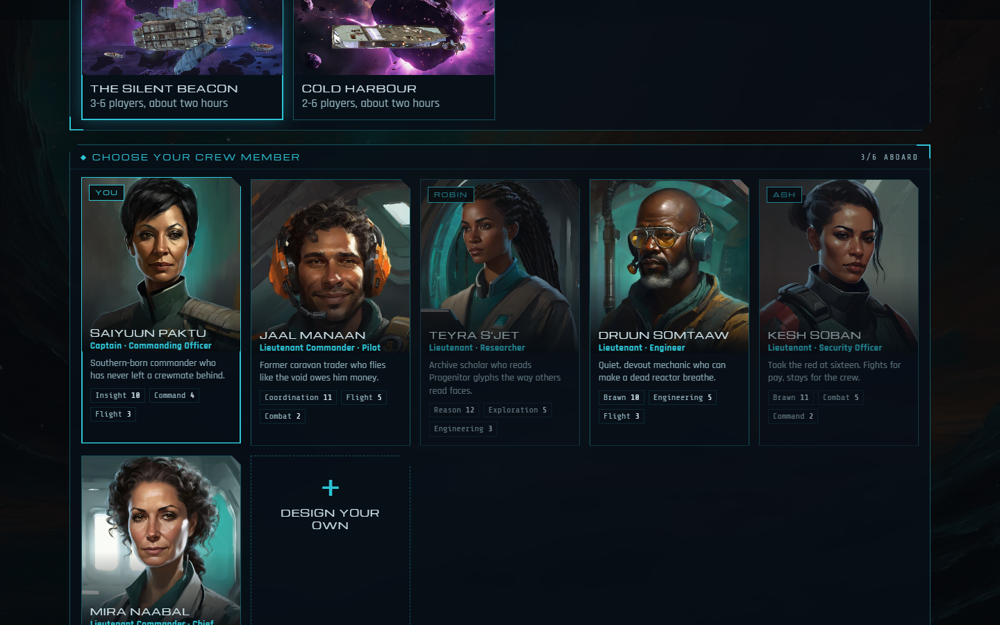
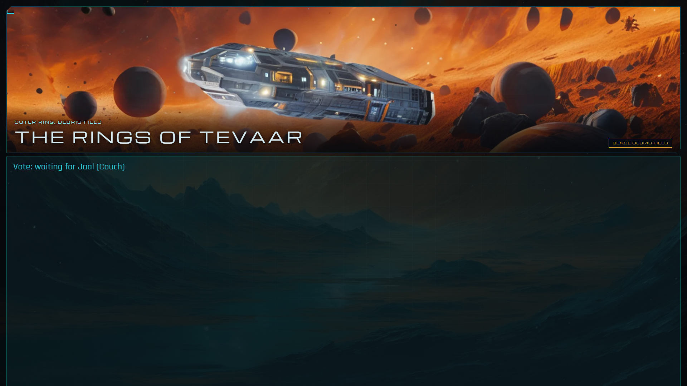
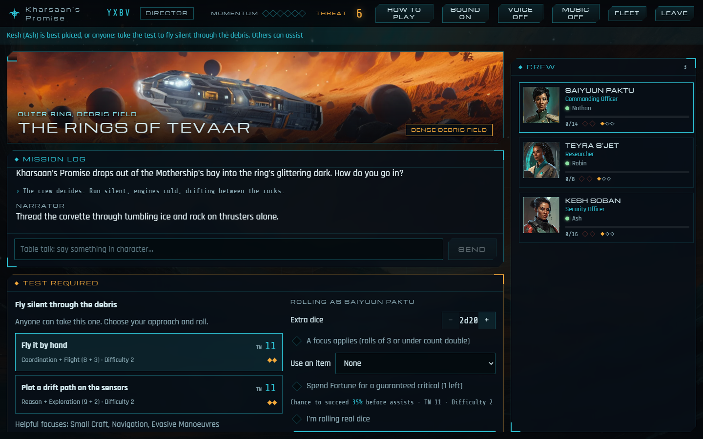
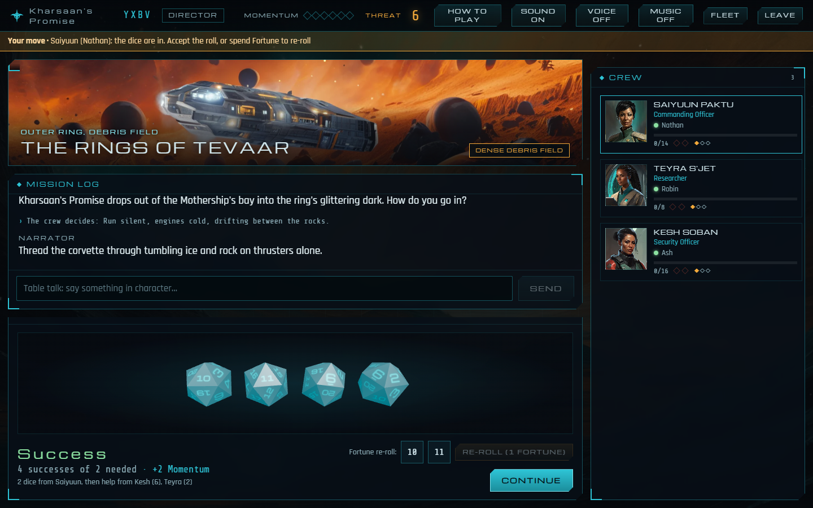
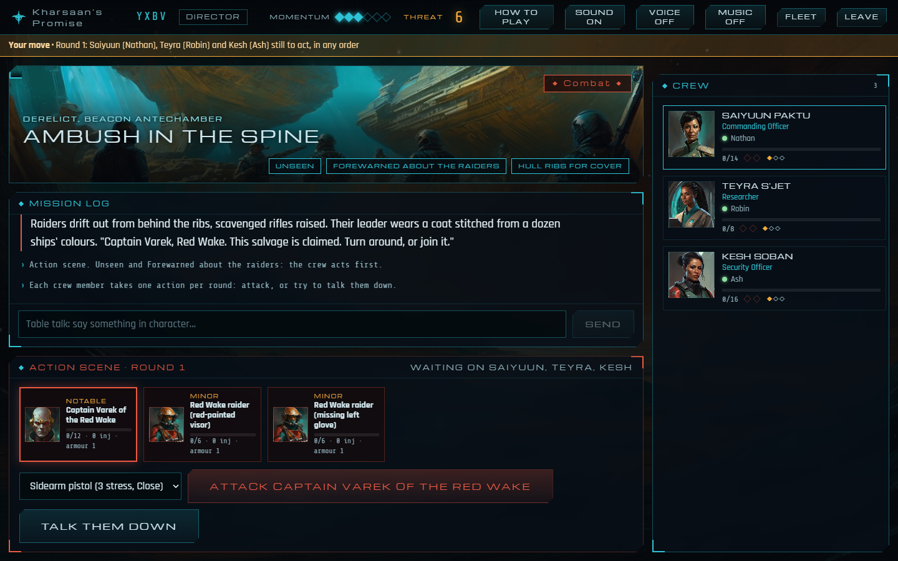

# Getting Started

How to run HWR-App on this PC, play a session with friends, and find your way around the code.



## Run it

You need Node 24 (with corepack) and Git LFS.

```bash
corepack pnpm install
corepack pnpm --filter @hwr/web build
corepack pnpm start
```

**On a laptop without dev tools**, build the portable folder with `corepack pnpm package:win`, copy `dist/HWR-App` across, and double-click `HWR-App.exe` (see [Launcher](Launcher.md)).

Open <http://localhost:8787>. Friends on the same network scan the QR code in the lobby (or on the TV view), which points at this PC's network address even when you're browsing at `localhost`. For friends elsewhere, share the port with Tailscale. If phones can't connect, check that Windows Firewall allows Node on the network you're using (see [Launcher](Launcher.md)).

For development, run the server and the Vite dev server side by side (`corepack pnpm --filter @hwr/server dev` and `corepack pnpm --filter @hwr/web dev`), then open <http://localhost:5173>; Vite proxies `/api` and `/ws` to the server.

### The Claude GM (optional)

Without a key, the **Director** runs every session, for free. To enable the **Claude GM**, open the host console (<http://localhost:8787/host>) and paste an API key from the Claude Console into the **Claude GM** panel. It's checked with Anthropic and saved beside the saves on this PC, and open tables can use it at once. The panel shows only its last four characters and has a *Remove key* button.

A Claude subscription (Pro or Max) can't be used instead: apps like this one aren't allowed to sign in with claude.ai, so the Claude GM is paid from Console API credit.

Alternatively, put the key in `HWR-App/.env` (git-ignored, never share it). A key there takes precedence:

```
ANTHROPIC_API_KEY=sk-ant-...
```

With `.env`, restart the server. The lobby's *Claude GM* option becomes available. It uses **Claude Haiku 5.5** (US$0.10 / $0.50 per million input / output tokens), the fastest and cheapest. If the narration isn't good enough, add `HWR_GM_MODEL=claude-sonnet-5-5` (twenty times the price) or `HWR_GM_MODEL=claude-opus-5-5` to `.env` and restart. The server ignores the PC-wide `ANTHROPIC_BASE_URL`; set `HWR_ANTHROPIC_BASE_URL` only if you really mean to use a proxy.

The Claude GM is paid for from prepaid API credit in the Claude Console, which is separate from a claude.ai subscription. Keep it in its own workspace with a monthly spend limit. If anything goes wrong mid-game, the Director carries on and the log says why:

| What happened | What the table sees | What to do |
| --- | --- | --- |
| Out of credit or spend limit reached | *Claude GM · paused* in the HUD | Top up on the Console's Billing page; it tries again within five minutes |
| Key rejected, expired or wrong workspace | *Claude GM · paused* | Paste a new key on the host console (or change `.env` and restart) |
| Claude busy or rate limited | A one-line note | Nothing; the next action tries again |
| No internet | A one-line note; paused for a minute | Check the PC's connection |

Saves live in `apps/server/data/hwr.sqlite`. Tables survive restarts: rejoin with the same code.

## How to play

1. **Launch a table** on the title screen and share the four-letter code or the invite link. Up to six players; others can join as spectators, and one person can join as GM.
2. **Choose a mission and a crew member** in the lobby. There are two missions in the repo: *The Silent Beacon* (a derelict, raiders and an escape) and *Cold Harbour* (a rescue in an ion storm, and a Taiidan officer who might defect). On a PC with the private folder there's a third, *The Khar-Toba*, adapted from the corebook's quickstart (see [Private folder](Private-Folder.md)). Each of the six has a full character sheet; click a portrait in the crew panel during play to read it.
3. **Pick a GM**:
   - **Director**: no setup and no API key. A scripted GM runs the mission, the NPCs and every roll.
   - **Claude GM**: the Director keeps the structure, and Claude responds to anything you type in the log ("I check the glyphs for traps") with narration, NPC voices and extra tests.
   - **Human GM**: a friend joins *As GM* and gets a console to narrate, spend Threat and call tests, while the Director runs the script.
4. **Before you begin**: the lobby, on phones and the TV, shows a short orientation for new players. It covers the mission's setting and what's at stake, then how a turn works.
5. **Play.** A line under the top bar (and under the scene on the TV) always says what the game is waiting for: a test anyone can take, who still has to vote, who's left to act this round, or Next. A phone that's needed shows **Your move** and buzzes. Every tap shows *Sending…* until the game answers.
   - **Continue** moves the story on.
   - **Votes**: the crew moves when everyone has voted.
   - **Assists**: while a test is waiting, anyone else can press **Assist (+1d20)** to add their own die. Assist successes count only if the person rolling scores at least one.
   - **Tests**: anyone can take an open test. Choose an approach and see your target number and chance of success. Buy up to three extra dice with Momentum (1, then 2, then 3) or by giving the GM Threat. Tick *a focus applies* when one of your focuses fits, then roll. After the dice land you can spend Fortune to re-roll some of them, then continue.
   - **Combat**: each crew member acts once a round. Pick a target and a weapon, or try to talk them down. Raiders shoot back after each of your turns.
   - **Ship battles**: everyone works a bridge station each round (fire, scan for weakness, evasive action, jam, damage control, rally, break away), rolled as the ship's system plus your skill. Spread out: repeating an action in the same round is harder.
   - **Extended tests**: the data core needs Work before the attempts run out. Spend Momentum on a success for extra Challenge Dice.
6. **Debrief**: the mission ends with the Requisition (RU) the crew earned.

**Playing on the couch**: open **Open TV view** from the lobby (or `/t/CODE/tv`) on a TV or big monitor. It shows the story, the dice and the crew with no controls, while everyone plays on their phones. **How to play** in the HUD opens a one-screen rules primer.

**The story read aloud**: the TV view reads narration aloud. Click or tap the TV screen once first, because browsers only allow sound after that. Phones stay quiet unless you press **Voice** in the top bar; the switch is per device.

- **With the Kokoro voices** in the private folder (see [Private folder](Private-Folder.md)), the game PC speaks every line itself, offline, with natural voices that sound the same on every device. George narrates, Emma speaks for Fleet Command, and each named character keeps a voice of their own: Mevath Sagald is Isabella and Ressa Vaal is Alice. A mission names its characters' voices in `voices`; anyone else gets a stable pick by name.
- **Without them**, or if the voice engine fails, the browser's own voices take over, with a different voice and pitch per speaker. The best free ones on Windows are Edge's "Natural" voices.

**Soundtrack**: with the soundtracks in the private folder (`python tools/music/build.py`, see [Private folder](Private-Folder.md)), the game plays Homeworld music to suit each scene: briefings, derelicts, danger, battles, and the ending. The Khar-Toba plays Deserts of Kharak's score instead. It plays on the TV view by default; press **Music** on any other device to hear it there. Without the music folder you hear the synthesised drone instead.



**Fleet archive**: on this PC (where the Homeworld Remastered source models are), the title screen and the in-game HUD have a **Fleet** button that shows the real ships in 3D. **Sound**: a quiet ambient drone and cues for dice, results, comms and Threat; toggle it in the HUD.







## Find your way around

| Path | What it is |
|---|---|
| `packages/rules-engine` | The 2d20 rules as pure functions: tests, dice, pools, stress, extended tests. Start with `src/test.ts`. |
| `packages/protocol` | Every message and every piece of table state, typed. |
| `packages/content` | The six crew, NPCs and *The Silent Beacon* mission graph, plus its validator. |
| `apps/server` | Fastify + WebSockets. `engine.ts` is the rules referee and Director; `claude-gm.ts` is the Claude GM; `store.ts` saves to SQLite. |
| `apps/web` | The React client: `components/` for screens, `dice/` for the 3D dice, `styles.css` for the HUD look. |
| `tests/e2e` | Playwright: three browsers play the whole mission. |
| `tools/art`, `tools/ship-studio` | The art pipeline (see [Art Pipeline](Art-Pipeline.md)). |

## Tests

```bash
pnpm turbo run test typecheck              # unit tests, 150 simulated playthroughs, typecheck
cd apps/server && npx tsx test/sim.ts      # balance: win rates by party size
cd tests/e2e && npx playwright test        # full three-player game in real browsers
cd apps/server && npx tsx test/virtual-table.ts --url http://localhost:8787   # the virtual family (below)
```

### The virtual family

`apps/server/test/virtual-table.ts` plays a whole mission against a **running** server (the repo's, or the portable build's on the laptop) the way a table does, over real WebSockets:
- bot players claim crew, vote, roll, accept, fight and press Next after human-like pauses;
- a TV spectator asks for Kokoro speech for every narration line, and the table waits for the story to be read before moving on, as people do;
- a probe checks the server's health every half second.

It reports how long each tap took to be answered, how the server responded, and how speech kept up. It passes if 95% of taps are answered within 500 ms, none take over 3 s, and the mission finishes. Options: `--players 1-6`, `--mission khar-toba`, `--think 400-1200` (pause range in ms), `--no-tts`, `--minutes`, `--json report.json`.

This is the test the laptop would have failed at the first family playtest, when the server was too busy making speech to answer taps. Run it on any new game PC before a game night: start HWR-App, then `npx tsx test/virtual-table.ts --url http://localhost:8787` from a copy of the repo, or from the desktop, pointing at the laptop's address.

