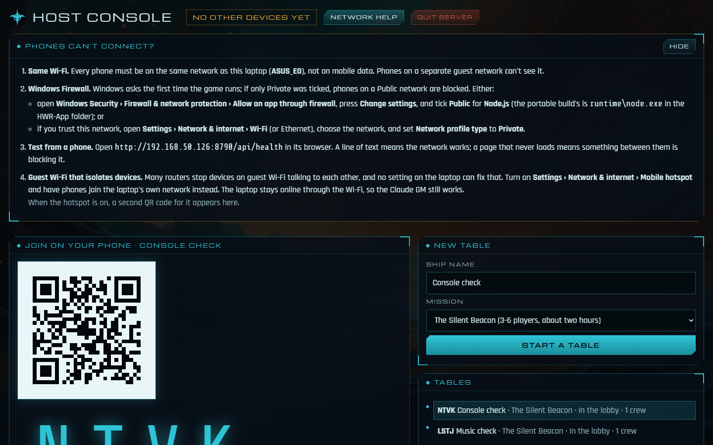

# Launcher and laptop hosting

Scope for running HWR-App from a laptop at a friend's house: double-click, everyone joins on their phones, the TV shows the table. This is a **private build for Nathan's own laptop**, not something we distribute.

Board: Feature #533 (F12.7) under E12, stories #534–#538.

## How it works today

The server listens on every network interface (`HOST` defaults to `0.0.0.0`, port `8787`; see `apps/server/src/main.ts`). Any device on the same network can open `http://<laptop's IP>:8787/t/CODE`, and the TV can open `.../t/CODE/tv`. Everything (pages, WebSocket, art, local ship models) comes from that one server, so no internet is needed except for the Claude GM.

The lobby and the TV view show a **QR code** and join address for the table. If the host is browsing at `localhost`, the page asks `GET /api/host-info` for the laptop's network addresses and uses the best one (`rankAddresses` in `apps/server/src/network.ts`: Wi-Fi and Ethernet first, virtual adapters such as WSL, Hyper-V and VPNs last). The QR code is drawn in the browser, so it works offline.

The two things that usually stop phones connecting at a friend's house are the Windows Firewall on a *Public* network and guest Wi-Fi that isolates devices. The host console's **Network help** covers both (below).

## Host console (built, #535)

Open `http://localhost:8787/host` on the PC running the server. It only opens there: other devices get a 403, and they get an empty list from `/api/tables`, so nobody on someone else's Wi-Fi can browse or stop your games. It shows:

- **Join on your phone:** a big QR code and code for the selected table at the laptop's network address, with *Open TV view* and *Join as a player*.
- **New table:** ship name and mission picker.
- **Tables:** recent tables to switch between.
- **Connected:** everyone connected right now, with their table and address. The top bar says how many *other* devices are connected; if that's above zero, the firewall and Wi-Fi are working.
- **This laptop:** every address (virtual adapters flagged), and which extras this PC has (Claude GM, ship models, family portraits, music, game sounds).
- **Quit server**, which stops it cleanly; saves are kept.

Code: `apps/server/src/host.ts` (`isLoopback`, `Devices`), `/api/host` and `/api/host/quit` in `main.ts`, `apps/web/src/components/HostConsole.tsx`.

## Portable build (built, #536)

```
corepack pnpm package:win               # dist/HWR-App, with the private folder
corepack pnpm package:win --no-private  # stock art and synthesised sound only
```

Copy `dist/HWR-App` to the laptop (a USB stick is fine) and double-click **HWR-App.exe**. It:

1. picks a free port from 8787;
2. starts `runtime\node.exe app\server.mjs` hidden, keeping saves, settings and `server.log` in `%LOCALAPPDATA%\HWR-App`;
3. waits for the server, then opens the host console as an app window;
4. stops the server when you choose *Quit HWR-App* in the tray, or press *Quit server* on the host console.

Nothing is installed; delete the folder to remove it. The build is about 1.3 GB with the private folder and about 320 MB without. With the private folder, ship models are 311 MB, music 474 MB (with the desert set) and the Kokoro voice model 97 MB. The voice engine itself, about 216 MB in `app/node_modules`, is in both.

- `tools/package/package-win.mjs`: builds the web client, bundles the server with esbuild (one ES module with a `require` shim for CommonJS dependencies), copies this PC's Node 24, compiles the launcher with the C# compiler that ships with Windows, and copies `ships`, `portraits`, `music`, `sfx`, `missions` and `tts` from `reference/`. The Kokoro engine can't be bundled: onnxruntime is a native module, and kokoro-js reads voices from its own folder. So `kokoro-js` and `@huggingface/transformers` stay external, and the packager copies them and their dependencies into a flat `app/node_modules`, keeping only the Windows x64 onnxruntime binary.
- `tools/package/launcher/Launcher.cs`: the tray launcher (WinForms, compiled as a Windows program with the badge as its icon).
- The server reads `HWR_WEB_DIST`, `HWR_PRIVATE_DIR`, `HWR_DATA` and `HWR_LOG_LEVEL`, so it runs outside the repo.

**First run on a new laptop:** antivirus (Norton on this PC) can hold a brand-new program for a minute or two before letting it run. The launcher says so and waits up to three minutes. Allow HWR-App if Norton asks.

**Private build:** with the private folder it contains licensed models, the soundtracks and family portraits. CI never runs the packager and the folder is git-ignored; don't share it. A `--no-private` copy is safe to give someone.

## The launcher (built, #834)

`HWR-App.exe` is a small Windows program with no console window. It wears the Kushan badge on the file, the taskbar and Alt+Tab. The private build uses the game's own `badges/kushan.tga`, coloured in the game's cyan on a dark tile (`reference/branding`). A `--no-private` build uses the emblem drawn for the web client (`tools/package/make-icon.mjs`, `pack-icon.py`).

1. **Double-click HWR-App.** The badge appears in the system tray and a notification says when the game is ready. Starting takes a few seconds, or a minute or two on a new laptop while antivirus checks it.
2. **The host console opens as an app window**: Edge with no address bar, its own taskbar entry and the badge for an icon. The app windows share a browser profile beside the saves, set to let narration and music play without a click first. Without Edge, the default browser opens instead.
3. **The tray menu** (right-click the badge) has *Open host console* (also a double-click), *Open TV view*, *Copy join link*, *Add desktop and Start menu shortcuts*, *Show server log* and *Quit HWR-App*. *Open TV view* opens `/tv` (see below). *Copy join link* puts the current table's network address on the clipboard, ready to paste into a message.
4. **Shortcuts:** on the first run it asks once whether to add HWR-App to the desktop and Start menu. Nothing is installed: the shortcuts point at the folder, and after a yes they're refreshed on each start in case the folder has moved.
5. **Quitting:** *Quit HWR-App* asks the server to stop cleanly (so the last moves are saved), then closes. *Quit server* on the host console closes the launcher too. A second double-click while it's running just opens the host console again. The server belongs to a Windows job object, so even if the launcher is killed, the server goes with it and never holds the port.

**The TV (#881):**
- **It opens on the TV by itself.** If a second screen is connected when the game is ready, or is plugged in later (or Windows+P switches to *Extend*), the launcher opens the TV view full screen on it, and the host console stays on the laptop. The TV window has an Edge profile of its own (`browser-tv`), which makes it a separate browser, so it honours the position and full-screen settings.
- **It follows the table.** `/tv` shows the table selected or started on the host console (`/api/host/current`, answered only on the game PC) and switches when the host picks another. Before there's a table it shows "Waiting for a table". So the TV never needs re-aiming.
- If the TV mirrors the laptop instead (*Duplicate*), the host console notices that only one screen is in use and suggests Windows+P → *Extend*.

Friends scan the QR code on the host console; it ticks off each phone as it connects, which is the real network test.

**At home, the desktop can be the server.** It's fast enough for the Kokoro voices. The laptop then only needs to show `http://<desktop address>:8787/t/CODE/tv` in Edge on the TV, full screen.

Checked with the packaged build: it started hidden on port 8787 with one server process; a second copy left the first alone; killing the launcher took the server with it; and the host console's Quit closed both and tidied up.

## The TV options, best first

| Option | Notes |
| --- | --- |
| HDMI from the laptop | Most reliable. The laptop's own browser has full WebGL for the dice and ships. |
| Cast a Chrome tab (Chromecast / Google TV) | Fine for the TV view. A bit of lag doesn't matter because it's display-only. |
| The smart TV's own browser | Often lacks WebGL or is very slow. Type the join address shown on the host console. |

## Network help (built, #538)



If a table exists and no other device has connected after a minute, the host console opens **Phones can't connect?** by itself; the *Network help* button opens it any time. Once any phone gets through, it stops appearing unasked. It walks through, in order:

1. **Same Wi-Fi**, naming the network the laptop is on.
2. **Windows Firewall.** The server reads how Windows classes each network (`Get-NetConnectionProfile`, read-only, cached for 30 seconds; `networkProfiles` in `apps/server/src/network.ts`). If one is **Public**, the panel says that's the likely culprit. Then it gives both fixes: allow Node.js on Public networks in Windows Security (the portable build's is `runtime
ode.exe`), or set a trusted network to Private. The app never changes firewall or network settings itself; that's the user's call.
3. **Test from a phone** by opening `http://<laptop>:<port>/api/health`: text means the network works, a page that never loads means something is blocking it.
4. **Guest Wi-Fi isolation.** No laptop setting fixes a router that isolates guests, so turn on Windows **Mobile hotspot** and have phones join the laptop's own network. Windows always gives the laptop `192.168.137.1` there; `rankAddresses` flags it as the hotspot, and the panel shows a second QR code for it. The Claude GM still works because the laptop stays on the Wi-Fi.

The address list also puts Wi-Fi and Ethernet first and marks virtual adapters (Hyper-V, WSL, VPNs), which phones can't reach.

Code: `apps/web/src/components/NetworkHelp.tsx`; `parseProfiles` and the hotspot flag are unit-tested in `apps/server/test/network.test.ts`.

## Packaging options considered

| Option | Size | Effort | Verdict |
| --- | --- | --- | --- |
| **Portable folder**: official `node.exe` + bundled server + `web/` + optional `ships/`, started by `HWR-App.exe` | about 90 MB | Low | **Recommended first.** Same Node as development (24, which has `node:sqlite`), no installer, delete the folder to uninstall. |
| Node single-executable application (SEA) | about 90 MB, one file | Medium | Later polish. It needs a CommonJS bundle (our server uses top-level `await`), and assets embedded or alongside. |
| Electron | about 200 MB | Medium | Gives a window and a tray icon, but the browser already does that job, and Electron's Node version may lag on `node:sqlite`. |
| Tauri with a Node sidecar | about 100 MB | High | Smallest native shell, but adds a Rust toolchain for little gain. |

So the launcher is a **portable folder**, built by one command (`pnpm package:win`). The UI is a web page (`/host`), and we're not wrapping it in a native shell. If a tray icon becomes important later, Tauri or Electron can wrap the same server without changing it.

### Folder layout

```
HWR-App/
  HWR-App.exe        launcher: starts the server, opens /host, closes cleanly
  runtime/node.exe   pinned Node 24
  app/server.mjs     esbuild bundle of apps/server and the packages
  app/web/           the built web client
  app/ships/         optional: prepared HWRM models copied from reference/ships
```

Saves and settings move from the repo's `apps/server/data` into the user profile (`%LOCALAPPDATA%\HWR-App`). That way rebuilding or replacing the folder never loses a campaign.

## Licensing and keys

- The laptop build may include the HWRM models from `reference/ships` because it stays on Nathan's own machine. **CI never builds the package**, and the package is never uploaded to the repo, artefacts or a share. `pnpm package:win` has a `--no-ships` flag for a clean build.
- The Claude GM key is pasted into the **Claude GM** panel on the host console, which only answers on the laptop itself. The server first checks the key with Anthropic's model list, which is free. It then saves it to `config.json` beside the saves (`%LOCALAPPDATA%\HWR-App\config.json` on the laptop) and switches live tables over without a restart. The console shows only the key's last four characters, the key is never logged, and *Remove key* deletes it. A key in an `.env` file still works and takes precedence. Code: `apps/server/src/settings.ts`, `/api/host/claude-key` in `main.ts`, `Hub.setAi`.
- Signing in with a Claude subscription instead of a key isn't allowed for apps like this one (#619), so the Claude GM is paid from Console API credit. With Haiku that's a few cents a session; the Director is free.

## Security on someone else's network

- Host-only endpoints (`/host`, the table list, settings) answer only requests from the laptop itself (loopback).
- Phones need the four-letter table code, which is in the QR link.
- Phones only ever need these: the lobby, `/t/CODE`, `/t/CODE/tv`, the WebSocket and static files.

## Stories

1. **Join by QR code** (#534, built): the lobby and TV view show the laptop's network address and a QR code, never `localhost`. (3 points)
2. **Host console** (#535, built) at `/host`, loopback only: addresses, devices connected, tables, *Open TV view*, *Quit*. (5 points)
3. **Portable Windows build** (#536, built): `pnpm package:win` produces the folder above, and it runs on a laptop with no dev tools. (5 points)
4. **Saves and settings in the user profile** (#537, built), with the Claude key set from the host console. (3 points)
5. **Network help** (#538, built): in-app firewall and hotspot guidance, plus this page kept current. (2 points)

Story 1 is worth doing first even without a launcher, because it fixes the `localhost` invite gap for home games too.
